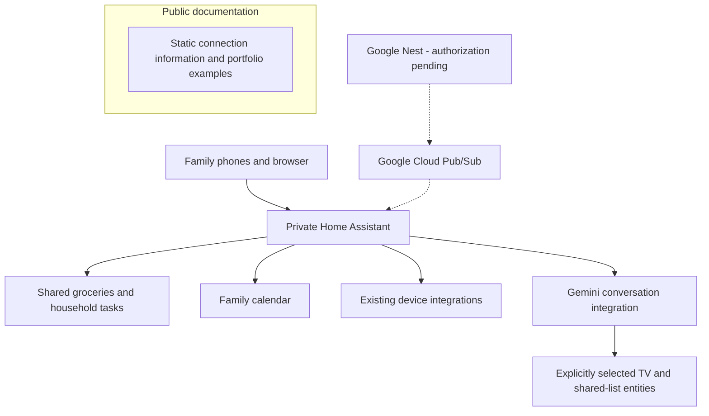

# Building a Family Home Hub

A personal Home Assistant project focused on making everyday household tasks easier: shared groceries, TV shortcuts, household tasks, and clear device status.

The goal is for family members to open one app and immediately find something useful. The design has shifted toward common actions and understandable feedback as the household tries it.

**Status:** Active work in progress. The feature status below records checks made during setup; it is not a promise of continuous availability or household adoption.

## What is working, and what is next

| Area | Implemented and checked | Remaining work |
| --- | --- | --- |
| Groceries | Shared list, quick add, keyword categories, completed items, and Undo; a temporary item was added, completed, restored, and removed during live checks | Broader usability feedback and testing across family devices |
| TV | App shortcuts and remote controls are configured | Reliable wake from a powered-off TV still needs a physical settings check |
| Household planning | Shared task list and family calendar are available; task add/remove was checked | Family onboarding and routine use |
| Device care | A dashboard brings together available maintenance and device status information | Tune which notices are useful in practice |
| Assistant | A small explicit set of TV and shared-list entities is exposed; a temporary task was added and removed through the assistant | Evaluate convenience and reliability in everyday use |
| Cameras | Camera viewing has been tested | Reliable simultaneous live viewing remains unresolved |
| Nest thermostat | Cloud APIs, OAuth credentials, and an event topic are prepared | Finish authorization and verify readings and controls |

## Included in this repository

- [Grocery card source and tests](examples/groceries/): a reusable frontend example using Home Assistant's existing to-do list services.
- [Engineering decisions](docs/decisions.md): specific tradeoffs and troubleshooting lessons.
- [Validation notes](docs/validation.md): what the checks cover and their limits.
- [Nest connection information](index.html), [privacy information](privacy.html), and [use information](terms.html): static explanatory pages for the planned personal thermostat connection.

The repository contains selected, sanitized examples. Production configuration, credentials, household images, device identifiers, and private connection details stay outside it.

## Logical architecture

This diagram explains the integration boundaries; it is not a home network map.



The public pages have no connection to the running home system. The thermostat is excluded from assistant exposure during this setup.

## A concrete frontend example

The grocery card handles details that matter when more than one person uses a list:

- Item identity comes from Home Assistant's item UID, so Undo restores the same item.
- Case and extra spaces are normalized for duplicate checks; quantities remain part of the item name.
- Newer shared-list updates take precedence over an older read response.
- Failed changes preserve the draft and show an error rather than silently retrying a write.
- Item names are rendered as text, including names that resemble HTML.

The card uses a small keyword rule set for categories. It does not track pantry inventory, infer quantities, or guarantee atomic duplicate prevention across simultaneous client writes.

Run the dependency-free mock tests with Node.js:

```sh
node --test examples/groceries/family-grocery-card.test.cjs
```

## Security and privacy choices

Household access uses Home Assistant accounts. Assistant entity exposure is explicit, and thermostat authorization is being staged separately. Sensitive device actions retain their confirmation flows. The public example includes no real camera images, floor plan, private endpoints, or credentials.

These choices reduce unnecessary exposure; they do not establish that the installation has passed a security audit. [The decisions and their limits](docs/decisions.md) are documented alongside the implementation.

## Project approach and credits

This project combines household requirements, configuration, existing official and community integrations, and custom frontend work. Development and validation were carried out with AI assistance. Home Assistant, Google, and community maintainers provide the underlying integrations; those connectors are not original work in this repository.

The emphasis is on understandable behavior, testing the actions that matter, and documenting unfinished work honestly.
